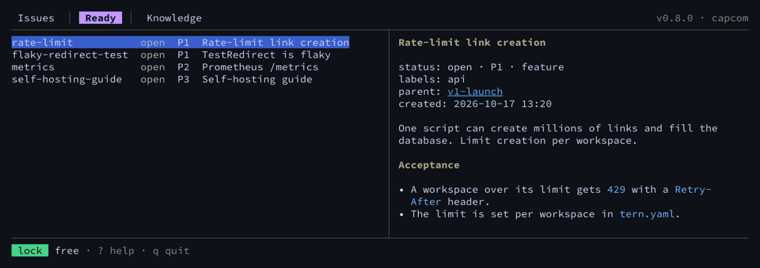

**Mission control for a repository and the coding agents working in it.**

capcom is a command-line issue tracker and project knowledge base built for AI coding agents such
as Claude Code, OpenAI Codex, Cursor, Gemini CLI and Aider, and for the people working beside
them. Issues and knowledge Notes are plain markdown files under `.capcom/`, versioned in git with
your code. There is no server, no account and no database to sync: one binary for Linux, macOS and
Windows.

In spaceflight, CAPCOM is the one voice on the ground that talks to the crew. `capcom` plays that
role for a code repository: it keeps the issue list, says who is currently working on the tree,
and answers the agents' questions about the project, all from plain files that live in the repo
itself. capcom is not affiliated with Capcom Co., Ltd., the video game company.

## Why capcom

Issue trackers built for agents tend to keep their data in two places: a database, and a file
exported from it for git. The two drift apart, and syncing them becomes a chore of its own. capcom
keeps a single source of truth, and that truth is files under git. Issues branch, merge and show
up in code review like the code they describe, and the SQLite index capcom queries is a cache it
rebuilds from those files whenever they change.

## Quick start

```sh
cd your-repo
capcom init                     # create .capcom/ in this git repository
capcom agents                   # tell your agents about capcom in AGENTS.md
capcom create --id first-task --title "Try capcom"
capcom ready                    # what to work on next
git add .capcom AGENTS.md       # plus CLAUDE.md or GEMINI.md when capcom agents changed them
git commit -m "chore: track issues with capcom"
```

[Install capcom](getting-started/install.md) first, then walk through a whole session, with real
output, in the [quick start](getting-started/quickstart.md).

## Concepts at a glance

| Concept | What it is | Read more |
| --- | --- | --- |
| Issue | One markdown file under `.capcom/issues/`, with a YAML header for status, priority, labels and dependencies. Its id is a readable slug you choose. | [Issues](concepts/issues.md) |
| Parent | The directory tree is the hierarchy: a child Issue is a file in its Parent's directory. | [Issues](concepts/issues.md) |
| Dependency | An Issue that must close before another one is ready. `capcom ready` lists only the Issues with nothing open in their way. | [Dependencies](concepts/dependencies.md) |
| Branches | Issues travel with the branch they were changed on; capcom warns about unmerged changes on other branches. | [Branches and merging](concepts/branches-and-merging.md) |
| Note | A small piece of project knowledge under `.capcom/knowledge/`, naming the files and symbols it talks about, so an agent reads only the part it needs. | [Knowledge](concepts/knowledge.md) |
| Tree lock | An advisory claim on the working tree: one agent session holds it while it edits, and every other one can see who, why and since when. | [Tree locks](concepts/tree-locks.md) |
| Briefing | `capcom prime` prints the ready work, the Issues in progress, the lock holders and the health of the store at the start of a session. | [The session briefing](agents/briefing.md) |

## Next steps

- [Install](getting-started/install.md): Homebrew, Scoop, winget, `go install` or a release
  archive.
- [Quick start](getting-started/quickstart.md): from `capcom init` to closing your first Issue.
- [Migrating from beads](getting-started/migrating-from-beads.md): move a repository off `bd`.
- [capcom compared](getting-started/comparison.md): capcom next to beads, GitHub Issues, Task
  Master and a `TODO.md`.
- [FAQ](getting-started/faq.md): short answers to the common questions.
- [Agent setup](agents/agent-setup.md): wire capcom into Claude Code, Codex and other agents.
- [CLI reference](reference/cli/capcom.md): every command, flag and example.
- [File format](reference/file-format.md): the files capcom keeps under `.capcom/`.
